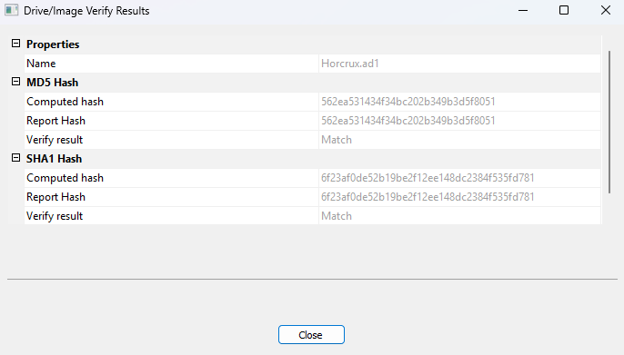
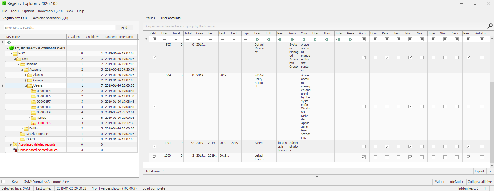
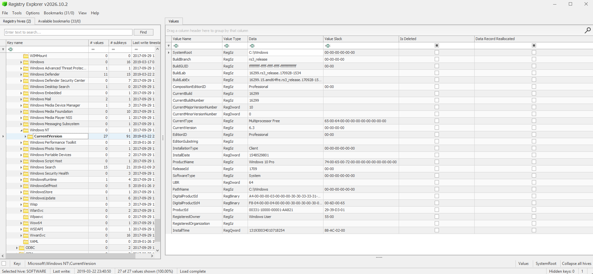
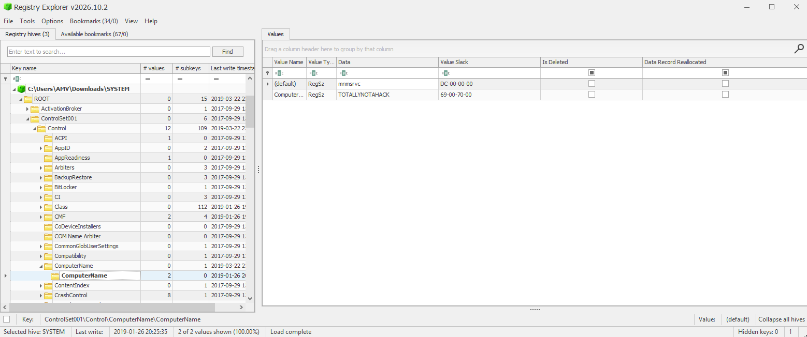
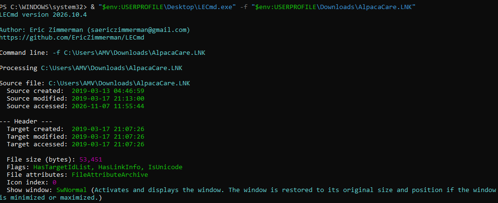
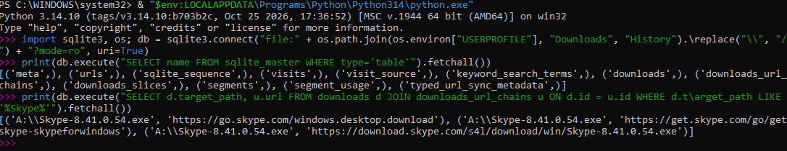
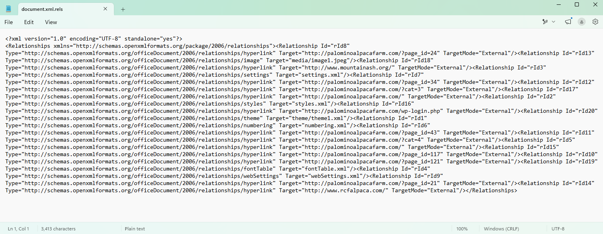
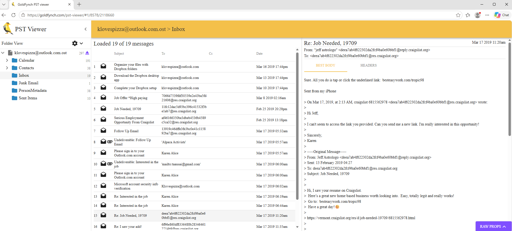
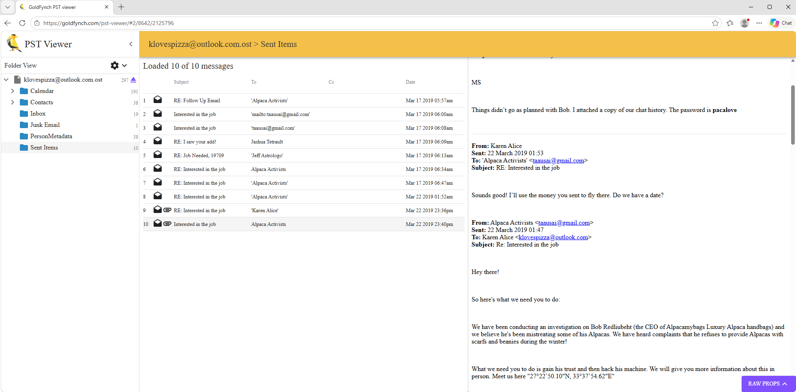

# HireMe — Windows Forensic Investigation

**Platform:** CyberDefenders  
**Difficulty:** Medium  
**Category:** Endpoint Forensics  
**Status:** Completed (17/17)  
**Date:** 7 November 2026  
**Environment:** Windows 11 VM — VMware Workstation Pro

## Overview

This investigation examines a Windows forensic image to reconstruct user activity through registry artefacts, file metadata, browser history and recovered email correspondence.

The analysis focused on identifying system information, examining user behaviour and correlating evidence from multiple sources while preserving the supplied forensic image.

## Tools Used

- **FTK Imager:** Forensic image examination and integrity verification.
- **Registry Explorer:** Windows Registry analysis.
- **LECmd:** Windows shortcut metadata analysis.
- **Python and SQLite:** Chrome download history analysis.
- **GoldFynch PST/OST Viewer:** Email examination.
- **WinRAR:** Office document structure inspection.

## Evidence Acquisition and Integrity

The supplied evidence consisted of an AD1 forensic image named `Horcrux.ad1`, extracted from the CyberDefenders dataset.

The original ZIP archive was identified using SHA-256. The AD1 image was then loaded into FTK Imager and verified against its internally recorded hashes.

| Algorithm | Verification |
|---|---|
| MD5 | Match |
| SHA-1 | Match |

Both checks passed. However, no independent reference hash was available to establish the authenticity of the downloaded evidence.

**Evidence — AD1 Integrity Verification**



## Investigation

### 1. Windows Registry Analysis

The `SAM`, `SOFTWARE` and `SYSTEM` registry hives were examined using Registry Explorer.

The analysis identified:

- Windows 10 Pro, build 16299.
- Hostname: `TOTALLYNOTAHACK`.
- User account: `Karen` (RID 1001).
- Membership of the local Administrators group.
- System time zone: UTC.
- Installed applications, including Chrome and Skype.

These artefacts established the system context and provided useful information for interpreting subsequent evidence.

**Evidence — Administrator Account**



**Evidence — Windows Version**



**Evidence — System Hostname**



### 2. Windows Shortcut and File Metadata

The `AlpacaCare.LNK` shortcut was examined using LECmd.

The shortcut referenced `AlpacaCare.docx` on a volume labelled `PacaLady`.

The target access timestamp recorded within the shortcut differed from the access timestamp recovered for the original document.

This demonstrated why timestamps from different forensic artefacts must be interpreted according to their source and meaning.

**Evidence — LNK Metadata Analysis**



### 3. Chrome Browser Forensics

Chrome's `History` SQLite database was extracted and analysed in read-only mode using Python.

The `downloads` and `downloads_url_chains` tables were correlated to recover information about a Skype installer download.

```sql
SELECT d.target_path, u.url
FROM downloads d
JOIN downloads_url_chains u ON d.id = u.id
WHERE d.target_path LIKE '%Skype%';
```

The recovered download records included the Skype installer and its associated download URLs.

This demonstrated how browser databases can preserve evidence of previous download activity.

**Evidence — Chrome Download History**



### 4. Document Analysis

The internal structure of `AlpacaCare.docx` was examined as an Office Open XML container without executing the document.

The file `word/_rels/document.xml.rels` contained external hyperlinks, including references to `palominoalpacafarm.com`.

An additional text file contained a reference to the Browser Exploitation Framework (BeEF).

These findings were recorded as potentially relevant artefacts, without assuming that the referenced content had been executed.

**Evidence — Document Hyperlinks**



### 5. Outlook Email Forensics

An Outlook OST file associated with the user was examined using GoldFynch.

Recovered messages included employment-related correspondence, suspicious offers and communications involving TAAUSAI.

The correspondence provided evidence of a proposed unauthorised activity and a planned meeting.

However, the available evidence did not establish that the user carried out the proposed intrusion.

**Evidence — Craigslist Correspondence**



**Evidence — TAAUSAI Correspondence**



## Security Analysis

The investigation highlighted the importance of correlating evidence from different Windows artefacts.

Key areas included:

- **User activity reconstruction:** Combining registry, shortcut, browser and email evidence.
- **Social engineering indicators:** Examining suspicious employment-related communications.
- **Timeline interpretation:** Considering timestamp origins and the system's UTC configuration.
- **Evidence-based conclusions:** Distinguishing observed facts from unverified assumptions.

The recovered correspondence contained indications of potentially malicious intentions, but did not independently establish that an intrusion had occurred.

## Limitations

- The AD1 container did not necessarily represent a complete physical disk acquisition.
- An independent trusted hash of the downloaded dataset was unavailable.
- The available artefacts did not establish a complete system compromise timeline.
- Suspicious links and documents were not executed.
- Findings were limited to the evidence available in the supplied dataset.

## Results

The investigation successfully completed all 17 CyberDefenders questions through the examination and correlation of Windows forensic artefacts.

It demonstrated practical experience in:

- Forensic evidence handling and integrity verification.
- Windows Registry examination.
- Shortcut and file metadata interpretation.
- SQLite database analysis.
- Email artefact recovery and examination.
- Evidence correlation and forensic reporting.

## Lessons Learned

- Verify forensic evidence before beginning an investigation.
- Interpret registry and file metadata in their correct context.
- Correlate multiple artefacts rather than relying on a single source.
- Preserve the distinction between evidence, interpretation and hypothesis.
- Document analytical limitations alongside findings.

## References

- [CyberDefenders — HireMe](https://cyberdefenders.org/blueteam-ctf-challenges/hireme/)
- [FTK Imager — Exterro](https://www.exterro.com/)
- [Eric Zimmerman's Tools](https://ericzimmerman.github.io/)
- [Python SQLite Documentation](https://docs.python.org/3/library/sqlite3.html)
- [GoldFynch](https://goldfynch.com/)
