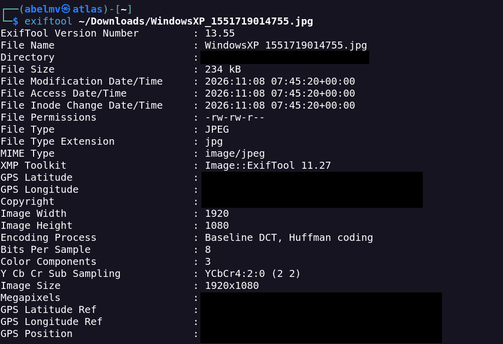
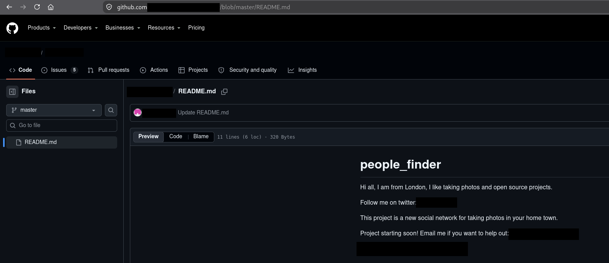
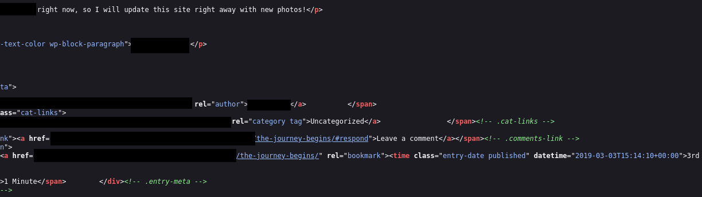

# OhSINT — TryHackMe

## Overview

| Field | Details |
|---|---|
| Platform | TryHackMe |
| Room | [OhSINT](https://tryhackme.com/room/ohsint) |
| Category | Open Source Intelligence (OSINT) |
| Difficulty | Introductory |
| Completion Date | 8 November 2026 |
| Status | Completed — 7/7 |
| Environment | Kali Linux |
| Main Tools | ExifTool 13.55, Firefox, Google, GitHub, X, WordPress |

## Objective

OhSINT is an introductory OSINT challenge on TryHackMe.

I completed this room to practise collecting and analysing information from publicly available sources. The investigation involved examining image metadata, researching online profiles and understanding how information from different websites can be connected.

All investigation activities were carried out using the authorised TryHackMe training scenario.

## Image Metadata Analysis

I started by examining the metadata of the image provided in the challenge.

Using ExifTool, I extracted information such as image properties, copyright metadata and GPS fields.

**Command used:**

```bash
exiftool ~/Downloads/WindowsXP_1551719014755.jpg
```

The output included several useful metadata fields:

| Field | Observation |
|---|---|
| File type | JPEG |
| Image resolution | 1920 × 1080 |
| Copyright | An identifier useful for further investigation |
| GPS metadata | Location-related information embedded in the image |

The copyright field provided a starting point for investigating publicly available profiles.

This exercise helped me understand that image metadata can reveal information that is not visible when simply viewing an image.

**Evidence — Image Metadata Analysis**



## Public Profile Investigation

After examining the image metadata, I searched for related identifiers using public websites and search engines.

I investigated available information on GitHub, X and WordPress and compared references between the different sources.

My approach involved:

- Searching for usernames and possible variations.
- Examining publicly accessible profile information.
- Looking for references to other online accounts.
- Comparing information across several sources.
- Distinguishing direct observations from possible connections.

I also examined a publicly available GitHub repository containing profile information and links to other platforms.

This helped me practise how separate pieces of public information can be connected during an OSINT investigation.

However, matching usernames alone does not prove that different accounts belong to the same person.

**Evidence — GitHub Profile Correlation**



## Wireless Network Investigation

Part of the challenge involved researching a wireless network identifier found in publicly available information.

I examined the difference between two important terms:

- **BSSID:** Identifies a wireless access point, usually using a MAC address.
- **SSID:** The network name advertised by a wireless network.

I attempted to use WiGLE to investigate the wireless network information, but I could not complete the registration and search process.

The network name was identified through secondary public references related to the exercise, rather than verified directly using WiGLE.

This was an important limitation, so I recorded it rather than presenting the result as independently confirmed.

## WordPress Source Code Inspection

I also investigated a publicly available WordPress blog associated with the challenge.

Using Firefox, I examined the page content and inspected its HTML source code.

**Method used:**

```text
Firefox → View Page Source (Ctrl + U)
```

The source contained information that was not immediately obvious from the visible page.

This helped me understand why inspecting HTML source code can be useful during an OSINT investigation and how publicly exposed content can create security risks.

**Evidence — WordPress Source Inspection**



## Results

I completed OhSINT on 8 November 2026, with all seven answers accepted by TryHackMe.

The investigation involved several different types of publicly available information:

| Investigation Area | Result |
|---|---|
| Image metadata | Extracted technical and location-related fields |
| Username research | Identified related public profiles |
| GitHub investigation | Examined publicly shared profile information |
| Wireless network research | Investigated an available wireless identifier |
| WordPress analysis | Examined blog content and HTML source code |
| Challenge validation | 7/7 answers accepted |

The exact challenge answers have been excluded from this public report.

## Security Analysis

This lab demonstrated how information shared across different online platforms can be combined to build a more detailed picture of a digital identity.

The main security concerns included:

- Reusing the same or similar usernames across different platforms.
- Publishing contact information that can be connected to other accounts.
- Sharing location-related metadata in images.
- Exposing wireless network information publicly.
- Leaving sensitive information in publicly accessible web content.

These findings highlight why reviewing publicly shared information is important for personal privacy and organisational security.

## Limitations

There were several limitations to the investigation:

- Image metadata can be modified and should not automatically be treated as reliable.
- Similar usernames do not necessarily belong to the same person.
- I could not independently verify the wireless network name through WiGLE.
- Information posted on a website or social media profile does not independently confirm a person's physical location.
- The investigation was limited to the public resources available in the training scenario.

Recording these limitations helped me separate confirmed observations from information that required further verification.

## Lessons Learned

OhSINT introduced me to a practical investigation process that was different from traditional network enumeration.

I learned how to use ExifTool to examine metadata and how that information can provide starting points for further research.

The lab also helped me understand the importance of comparing information across multiple sources instead of relying on a single result.

Another useful lesson was recognising the difference between information I verified directly and findings obtained from secondary sources.

Overall, the exercise helped me improve my OSINT research, evidence collection and documentation skills.

## Evidence and Responsible Publication

Three screenshots are included in this report:

- **E01:** Image metadata analysis using ExifTool.
- **E02:** Investigation and correlation of public GitHub information.
- **E03:** WordPress HTML source code inspection.

The screenshots have been prepared for public release by hiding challenge answers and identifying details.

The original investigation notes and unmodified screenshots are kept in my private Obsidian knowledge base.

This public report focuses on the methodology, tools and skills practised without providing a complete solution to the challenge.

## References

- [TryHackMe — OhSINT](https://tryhackme.com/room/ohsint)
- [ExifTool](https://exiftool.org/)
- [WiGLE](https://wigle.net/)
- [GitHub](https://github.com/)

---

*Part of the [Cybersecurity Labs](../../README.md) repository.*
