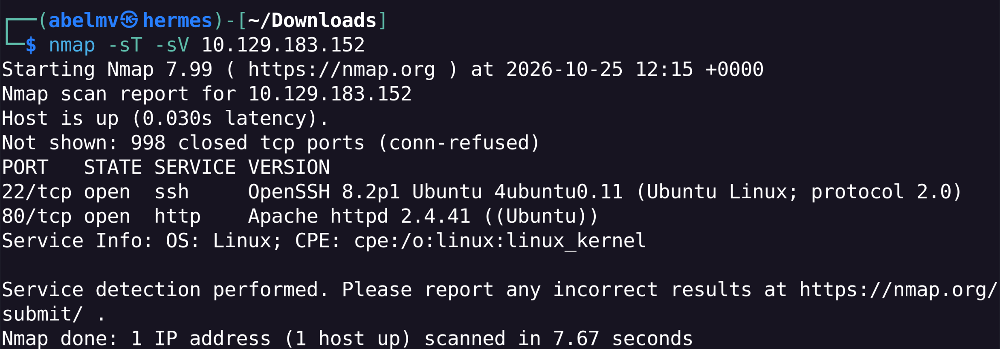
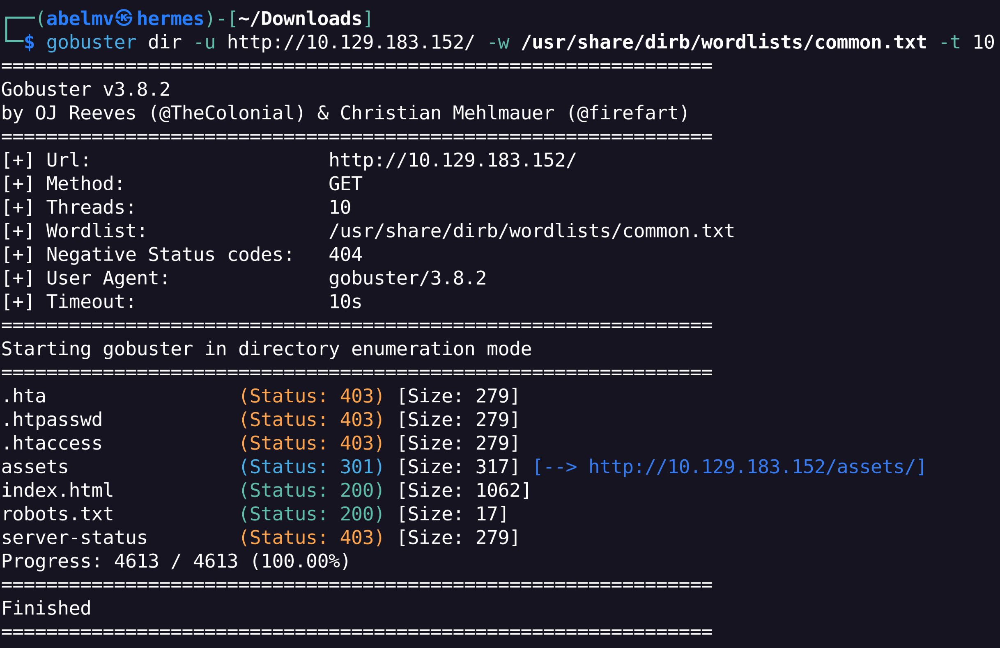
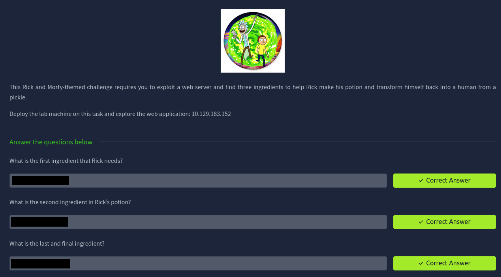

# Pickle Rick — TryHackMe

## Overview

| Field | Details |
|---|---|
| Platform | TryHackMe |
| Room | [Pickle Rick](https://tryhackme.com/room/picklerick) |
| Difficulty | Introductory |
| Completion Date | 25 October 2026 |
| Status | Completed |
| Environment | Kali Linux |
| Main Tools | Nmap, Gobuster, Firefox, Linux utilities |

## Objective

Pickle Rick is an introductory cybersecurity challenge on TryHackMe.

I completed this room to practise network reconnaissance, web enumeration, Linux commands and basic privilege escalation concepts.

The aim was to follow a structured approach, understand the results of each tool and identify security weaknesses in an authorised training environment.

## Network Reconnaissance

I started by checking the target's connectivity and using Nmap to identify accessible TCP services.

The scan was performed with:

```bash
nmap -sT -sV <TARGET_IP>
```

The options used were:

- `-sT`: Performs a TCP Connect scan.
- `-sV`: Attempts to identify service versions.

This helped me understand which services were exposed and decide where to focus the next stage of the investigation.

**Evidence — Nmap Service Enumeration**



## Web Enumeration

After identifying a web service, I inspected the application manually using Firefox and carried out directory enumeration with Gobuster.

The initial enumeration used:

```bash
gobuster dir -u http://<TARGET_IP>/ -w /usr/share/dirb/wordlists/common.txt -t 10
```

The main options were:

- `dir`: Selects directory and file enumeration.
- `-u`: Specifies the target URL.
- `-w`: Specifies the wordlist.
- `-t 10`: Sets the number of concurrent threads.

This process helped me practise identifying accessible web resources and interpreting HTTP response codes.

I also learned that an HTTP response does not always confirm the existence of a physical file or directory. For example, a `403 Forbidden` response may be generated by server access rules.

**Evidence — Gobuster Initial Enumeration**



## Additional Skills Practised

### Web Application Analysis

I used Firefox to inspect the application and understand how information exposed through web resources can affect security.

### Linux Enumeration

The lab helped me practise navigating the Linux file system, examining files and directories, and understanding ownership and permissions.

### Command Execution and Privileges

I explored how the execution context of a command affects the level of access available on a Linux system.

This reinforced the importance of the principle of least privilege and secure configuration of service accounts.

## Security Concepts

The main security concepts covered during this lab were:

- Network reconnaissance and service enumeration.
- Web content discovery.
- Information disclosure.
- Authentication and access control.
- Operating system command execution.
- Linux file ownership and permissions.
- Privilege escalation risks.

## Results

I successfully completed Pickle Rick on 25 October 2026, with all three challenge answers accepted by TryHackMe.

**Evidence — Room Completion**



The screenshot has been edited to hide the challenge answers while keeping the completion results visible.

## Lessons Learned

This was one of my early practical cybersecurity labs, and it helped me connect networking, web security and Linux concepts.

Using Nmap and Gobuster gave me more practice interpreting technical output rather than simply running commands.

I also learned how important it is to combine automated enumeration with manual investigation and to understand the permissions under which applications and processes operate.

Another useful part of this lab was documenting the work. Recording the commands, observations and results made it easier to review the exercise afterwards.

## Documentation and Evidence

The complete technical writeup is stored privately in my Obsidian knowledge base, together with the original screenshots.

This public version includes selected evidence of reconnaissance, enumeration and challenge completion.

Detailed solution steps, credentials and challenge answers have been excluded to avoid revealing the intended solution.

## References

- [TryHackMe — Pickle Rick](https://tryhackme.com/room/picklerick)
- [Nmap Documentation](https://nmap.org/book/man.html)
- [Gobuster](https://github.com/OJ/gobuster)
- [OWASP Web Security Testing Guide](https://owasp.org/www-project-web-security-testing-guide/)

---

*Part of the [Cybersecurity Labs](../../README.md) repository.*
